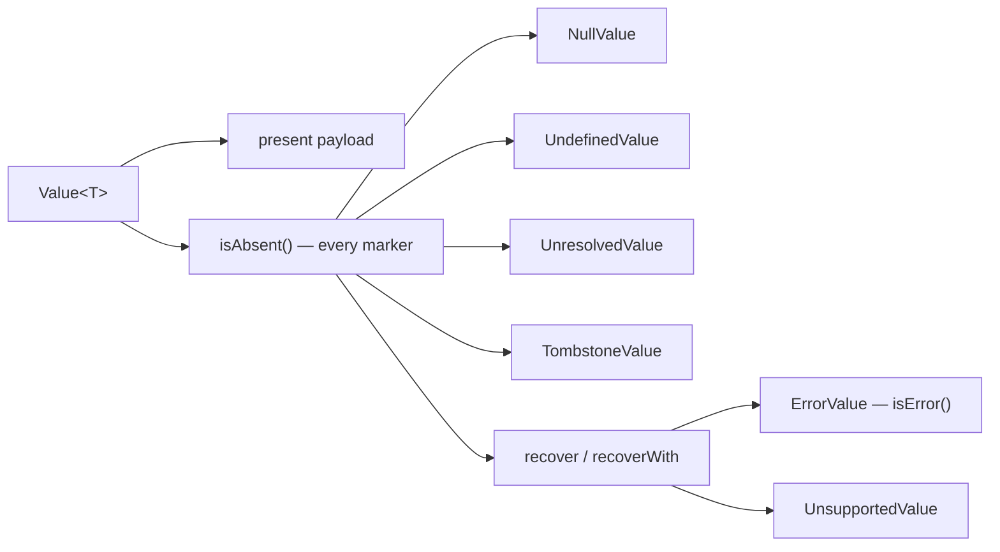

# Explicit State

A `Value<T>` is either present, with a payload of type `T`, or one of six state markers. The markers replace scattered
null checks with states you spell and match on:

```java
Value<String> none = Value.nullValue();        // NullValue — "null" was chosen on purpose
Value<String> missing = Value.undefined();     // UndefinedValue — no value was ever supplied
Value<String> later = Value.unresolved();      // UnresolvedValue — exists, but not resolved yet
Value<String> gone = Value.tombstone();        // TombstoneValue — explicitly removed
Value<String> bad = Value.uuidOf("?").convertTo(String.class);   // ErrorValue — this value was refused
Value<Integer> cannot = Value.of(UUID.randomUUID()).convertTo(Integer.class);
                                               // UnsupportedValue — the request cannot be served
```

The state checks act on sets of markers, and so do the combinators that recover:



```java
missing.isAbsent();    // true — every marker is absent
missing.isError();     // false — only an ErrorValue is an error
cannot.isError();      // false — unsupported is not an error ...
cannot.recover(0);     // Value.of(0) — ... but recover applies to both
gone.isDefined();      // true — a tombstone is defined and not null, only removed
```

## Reading a value

Pattern-match on the sealed hierarchy when you handle several states in one place; the compiler checks the switch is
complete:

```java
Value<Integer> port = Value.of(8080);
String label = switch (port) {
  case IntegerValue i -> "port " + i.intValue();
  case UndefinedValue<?> _ -> "not configured";
  case ErrorValue<?> e -> "bad port: " + e.errorMessage().orElse("?");
  default -> "unusable";
};                                             // "port 8080"
```

Use the `is...()` checks and the `as...()` accessors when one question suffices. The accessors are same-type only: a
number read as a string, or a string as a number, goes through `convertTo(Class)`
([Converting values](converting-values.md)).

```java
port.isNumber();                               // true
Value.of("8080").asLocalDate();                // Optional.empty — same-type only, no parsing
```

## Your own types

Any object becomes a value with `Value.of`, nothing to declare:

```java
record Point(int x, int y) {}
Value<Point> point = Value.of(new Point(1, 2));   // BoxedValue<Point>
```

A type that `implements CoreValue<T>` _is_ a `Value<T>`: pattern-matched by name, streamed through marshalling without
`.map(Value::of)`, one allocation instead of two. The one method to implement is `valueType()`, which answers the type's
descriptor, or `null` when a write must be given one:

```java
record Tag(String name) implements CoreValue<Tag> {
  @Override
  public TypeDescriptor<Tag> valueType() {
    return null;
  }
}
Value<Tag> tag = new Tag("urgent");            // the record is its own Value
String shown = switch (tag) {
  case Tag t -> t.name();                      // by name, not "case BoxedValue<?> b when b.inner() instanceof Tag"
  default -> "(absent)";
};                                             // "urgent"
```

## The value cache

Built-in values are interned in a process-wide cache under one `ValueCachePolicy`, read once from the
`zems.value.cache.*` system properties at class initialisation; no call site chooses it. The policy is a deployment knob
for whoever owns the JVM, like a heap size. Equality is by value and identity is never a contract, so your code does not
change with the policy.

| Preset       | `int.max`           | `long.max`          | `string.max` |
| ------------ | ------------------- | ------------------- | ------------ |
| `DEFAULT`    | 32 767              | 32 767              | 1 024        |
| `AGGRESSIVE` | 32 767              | 32 767              | 8 192        |
| `MINIMAL`    | 0                   | 0                   | 0            |
| `UNBOUNDED`  | `Integer.MAX_VALUE` | `Integer.MAX_VALUE` | unbounded    |

`DISABLED` is the same policy as `MINIMAL`. Select a preset with `-Dzems.value.cache.mode=<preset>` (case does not
matter); override one bound with `-Dzems.value.cache.int.max=`, `-Dzems.value.cache.long.max=` or
`-Dzems.value.cache.string.max=` (each accepts `unbounded`). Booleans, bytes, shorts and the empty collections are
always cached, whatever the policy.

## Choosing

**Which marker to produce.** `nullValue()` when "null" was chosen on purpose. `undefined()` when no value was ever
supplied: configuration overlays and patch or merge flows need "explicitly null" and "never set" to behave differently
downstream. `unresolved()` for "ask again later, the answer is coming": lazy-loaded fields, pending lookups, references
not yet dereferenced; a consumer that matches it triggers the resolution and re-reads. `tombstone()` when a slot was
explicitly removed and that must stay distinct from "never set" or "missed": replicated stores, versioned data, cache
invalidation. An `ErrorValue` and an `UnsupportedValue` come from the library's own operations;
[Errors as values](errors-as-values.md) says when to build one yourself.

**Pattern matching or accessors.** Match when several states take different paths, so the switch stays complete. Use
`is...()` and `as...()` when one check or one read is all you need.

**Your own type.** Do nothing (`BoxedValue`) for everything else. Choose `CoreValue` when the type lives in
`Map<String, Value<?>>` attribute slots, is pattern-matched in user-facing switches, or streams through marshalling at
scale.

**The cache.** Leave `DEFAULT` unless you measured. `AGGRESSIVE` for a process that interns many distinct short strings,
`MINIMAL` for one that creates few values and wants the fixed footprint only, `UNBOUNDED` only where every integer and
string the process ever creates should be shared. Set it on the JVM command line, not in code.

The direction page says why the library's values carry no identity:
[Project Valhalla](jdk-directions.md#project-valhalla-values-without-identity).
