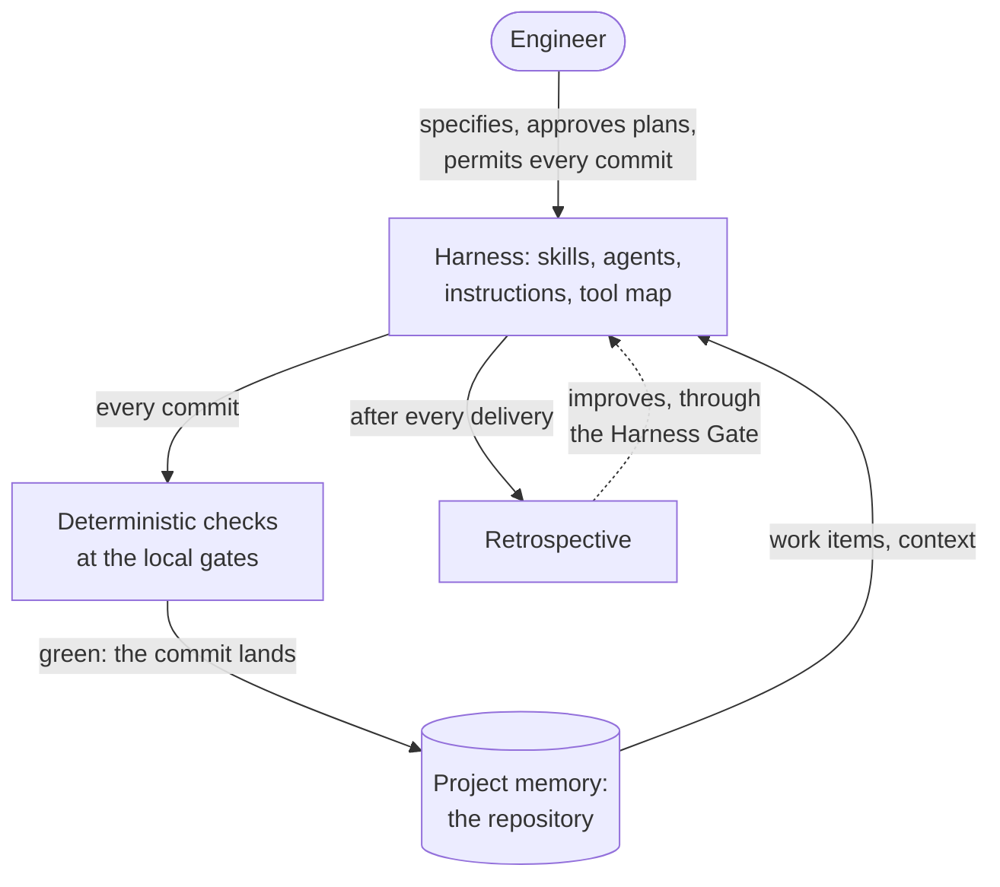
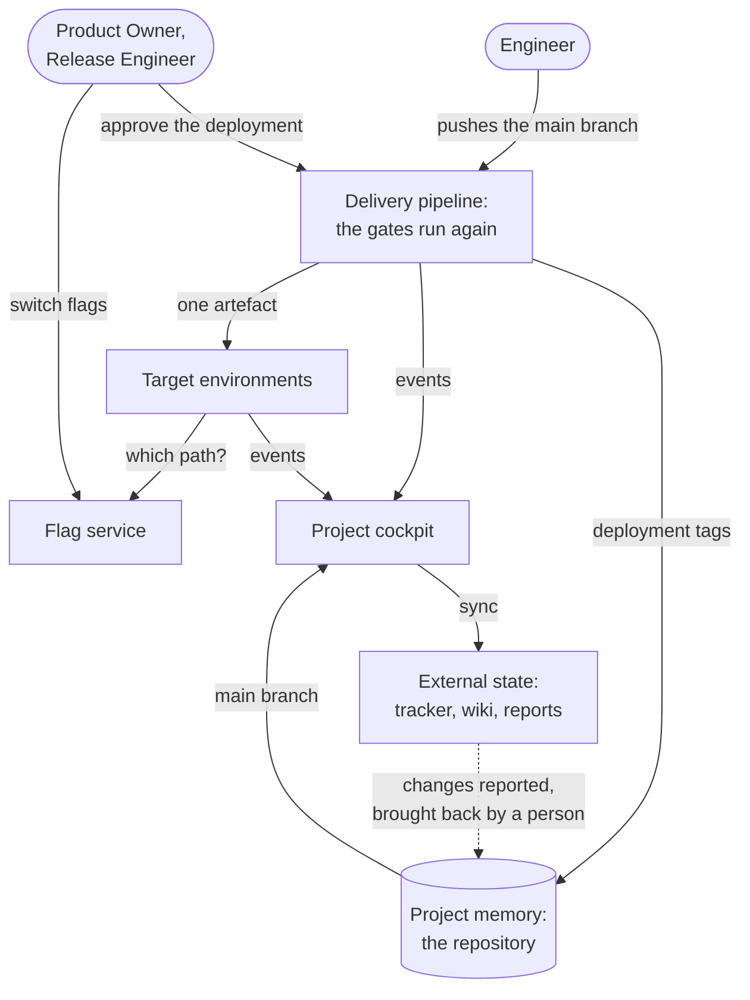
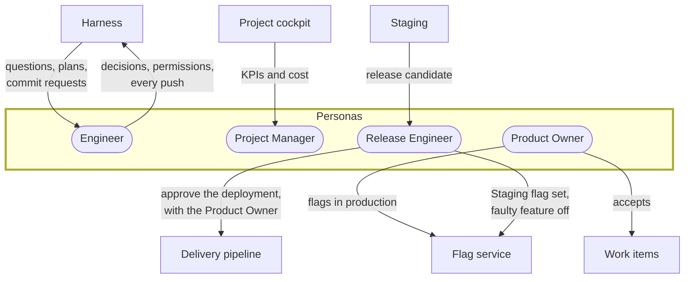
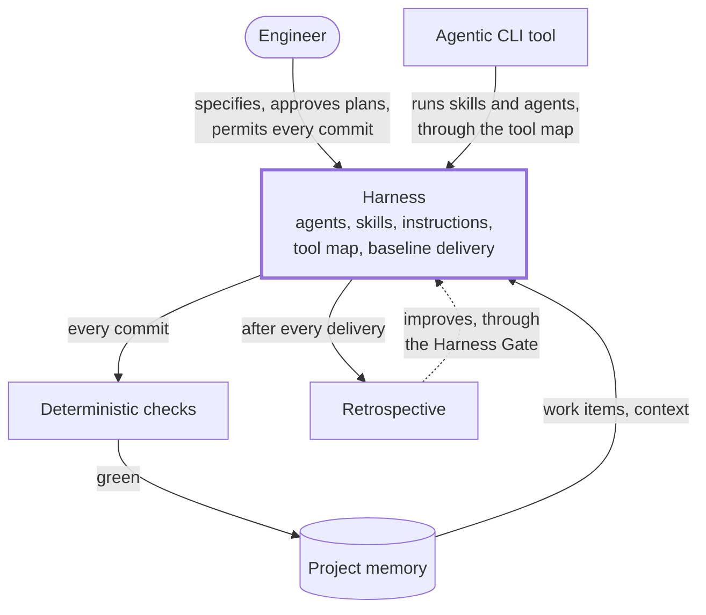
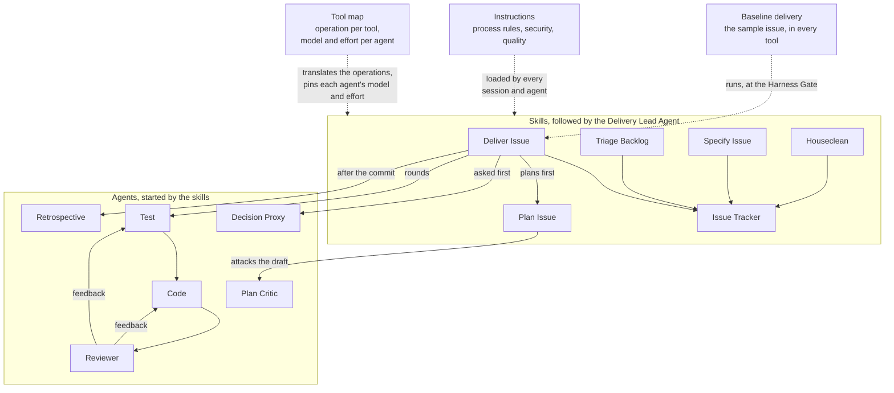
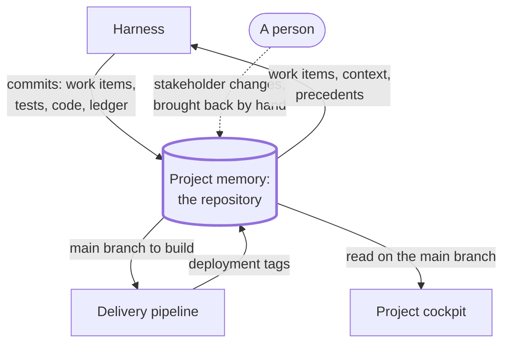
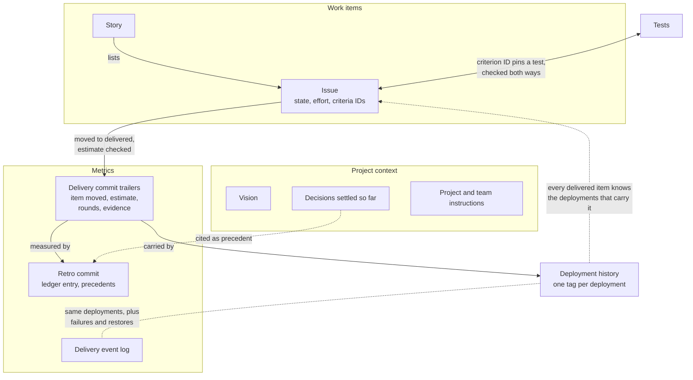
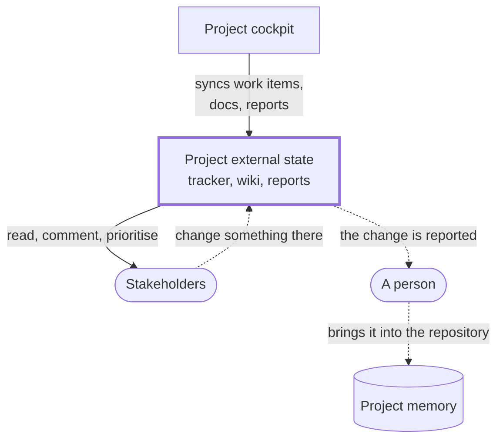
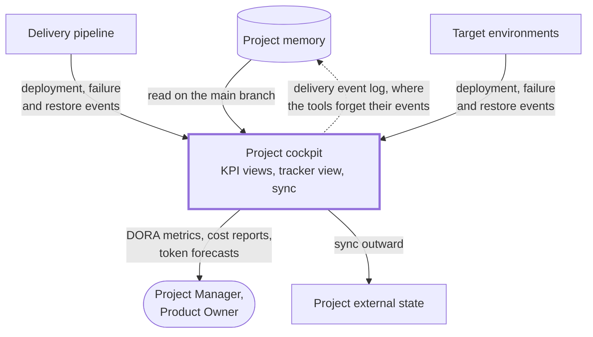

# Building Blocks

The model is built from a small number of blocks. The personas are the people; the harness is the reusable machinery;
the project memory, the external state and the cockpit hold and show what the project knows. The checks, the gates and
the environments have pages of their own.

The blocks interact along two paths that meet in the repository. On the developer machine, the Engineer steers the
harness, the harness works in the repository, nothing lands without passing the checks, and the retrospective points
back at the harness itself:

From the repository, the pipeline carries every pushed commit to the environments, the people who own production approve
each deployment and release features by flag, and the cockpit mirrors the repository and the delivery events to the
stakeholders:

| Name                                                                           | Role                                                                                                                         |
| ------------------------------------------------------------------------------ | ---------------------------------------------------------------------------------------------------------------------------- |
| [Personas](#personas)                                                          | The people who specify, decide, deliver and measure the work                                                                 |
| [Harness](#harness)                                                            | The reusable machinery that runs the delivery; adapted from project to project                                               |
| [Project Memory](#project-memory)                                              | Everything the project knows and decides, kept in the repository                                                             |
| [Project External State](#project-external-state)                              | Where the communication with the stakeholders happens, in the tools they use                                                 |
| [Project Cockpit](#project-cockpit)                                            | Shows KPIs derived from the project memory and keeps the external state in line with it                                      |
| [Deterministic Checks](checks-and-gates.md#deterministic-checks)               | Tests, linters and commit hooks that verify facts instead of an LLM                                                          |
| [Gates](checks-and-gates.md#gates)                                             | The transitions between the stages of the process, each with its checks and its human decision, if any                       |
| [Local Development Environment](environments.md#local-development-environment) | The developer machine the agentic process runs on, set up the same way for everyone                                          |
| [Delivery Pipeline](environments.md#delivery-pipeline)                         | The full CI/CD chain from a commit to production, with the gates run again and a human approving every production deployment |
| [Delivery Target Environments](environments.md#delivery-target-environments)   | Where the pipeline deploys to, and what each environment is for                                                              |
| [Feature Flag Management](environments.md#feature-flag-management)             | Separates merging a change from releasing it, and controls who sees what in each environment                                 |

## Personas

Personas are roles, not job titles. One person can take several.

| Name             | Role                                                                                                                                                                                                                                                                                                                                 |
| ---------------- | ------------------------------------------------------------------------------------------------------------------------------------------------------------------------------------------------------------------------------------------------------------------------------------------------------------------------------------ |
| Engineer         | Runs the agentic process on their machine, specifies the work with LLM support, decides where precedent or confidence is missing, approves plans, does every step outside the repository and gives every commit permission                                                                                                           |
| Product Owner    | Owns the requirements and the stakeholders' vision; settles open questions about what to build and, in tandem with the Release Engineer, accepts the release candidate on Staging and approves its deployment to production; decides when a tested and verified feature is released to users by switching its flag in production     |
| Project Manager  | Tracks the KPIs and the cost: the DevOps Research and Assessment (DORA) metrics against the team's cost, and the token ledger for cost forecasts; reports both to management                                                                                                                                                         |
| Release Engineer | Governs the Staging flag set and verifies the release candidate there, approves the production deployment in tandem with the Product Owner, switches a faulty feature off by its flag, and leads a rollback only when a deployment fails catastrophically. The role rotates among the engineers, so it never turns into a gatekeeper |

## Harness

The harness is the part of the process that does not belong to one project. When the process moves to the next project,
the harness is adapted, not rebuilt: what carries over is the pattern, and each project's harness is one implementation
of it (see [Adopting the Model](adopting.md)).

A harness is built for one reference tool first. In practice this also serves interoperability: several agentic CLI
tools read the same context files, skills and agent definitions, so one harness can serve them all. The reference tool
stays the reference; where another tool falls short, the gap is named in the tool map, and the reference path is never
weakened to match. The risk is that the shared formats are one vendor's own, not an agreed standard: a change in the
reference tool, or another tool dropping its support, would break the shared harness. The baseline delivery in each
supported tool shows such a break early. Portability across model providers is a separate claim: it is proven only once
the harness runs on a second provider's models, not by running several tools on one provider.

| Name                  | Role                                                                                                                                                        |
| --------------------- | ----------------------------------------------------------------------------------------------------------------------------------------------------------- |
| [Agents](#agents)     | The agents that plan, build, check and improve the work, each with one role                                                                                 |
| [Skills](#skills)     | Written playbooks for each workflow step, in tool-neutral terms                                                                                             |
| Instructions          | The instruction files that form the harness: process rules, security by design and quality guardrails                                                       |
| [Tool Map](#tool-map) | Says for each supported CLI tool what to call for each operation and which model and effort each agent runs on, and names the gaps where a tool falls short |
| Baseline Delivery     | A fixed sample issue delivered end-to-end in each supported tool, to check every harness change on the same work                                            |

Inside the harness, the skills build on the Issue Tracker skill and start the agents; the instructions and the tool map
reach every part, and the baseline delivery exercises the whole chain:

### Agents

| Name                 | Role                                                                                                                                                                                                                                                                                     |
| -------------------- | ---------------------------------------------------------------------------------------------------------------------------------------------------------------------------------------------------------------------------------------------------------------------------------------- |
| Delivery Lead Agent  | Runs the main session from specification to commit: starts and resumes the other agents with pointers, not prose, relays verdicts and questions to the human, and is the only one that commits                                                                                           |
| Decision Proxy Agent | Optional: answers decisions on the human's behalf where precedent and high confidence are given, records each one with the precedent it rests on in the project memory, in the commit as the token ledger is, so the human can check and overturn it, and escalates every other decision |
| Plan Critic Agent    | Attacks a draft plan against the code base and the rules before the human approves it; reads only                                                                                                                                                                                        |
| Test Agent           | Writes the tests from the plan's acceptance criteria before the code exists; never touches production code                                                                                                                                                                               |
| Code Agent           | Writes the production code until the tests pass; never edits tests                                                                                                                                                                                                                       |
| Reviewer Agent       | Runs the tests, reviews the test and code changes against plan, requirement and rules, returns a verdict with feedback per agent and prepares the commit; never edits code                                                                                                               |
| Retrospective Agent  | After every delivery, measures the run and proposes only process changes with evidenced impact; applies only what the human approves                                                                                                                                                     |
| Research Agent       | Sweeps the code base read-only and returns only its conclusion, so the delivery lead's context stays small                                                                                                                                                                               |

### Skills

The skills follow the life of a work item, from a jotted idea to a delivered change.

| Name           | Role                                                                                                                          |
| -------------- | ----------------------------------------------------------------------------------------------------------------------------- |
| Issue Tracker  | Creates, jots, splits, moves and lints the work items in the repository; the base the other skills build on                   |
| Triage Backlog | Gives every parked idea a verdict (remove, leave or specify) checked against the code, and recommends the one to specify next |
| Specify Issue  | Turns an idea into one or more work items with testable acceptance criteria, in a dialogue with the human                     |
| Plan Issue     | Turns one work item into a plan grounded in the code, attacked by the Plan Critic Agent and approved by the human             |
| Deliver Issue  | Runs the delivery from the approved plan through test, code and review rounds to the commit and the retrospective             |
| Houseclean     | Sweeps the open and delivered work items for stale claims, dead references and weak acceptance criteria                       |

### Tool Map

The skills name operations, never tool calls; the tool map translates them for each supported tool and names the gaps.
The operations are the interface a tool must offer, and the list is the generalisable part of the map:

| Operation                                  | What the map says per tool                                                                                            |
| ------------------------------------------ | --------------------------------------------------------------------------------------------------------------------- |
| Ask a structured question                  | The tool's structured question call or form; every permission gate goes through it                                    |
| Enter and leave plan mode                  | The tool's plan mode; where a tool cannot enter it itself, the agent asks the human to switch                         |
| Approve a plan                             | The tool's plan approval dialogue                                                                                     |
| Start an agent                             | The call that starts a subagent with its name, model and effort; the identifier it returns is recorded for the resume |
| Resume an agent                            | The call that sends a follow-up to a recorded identifier, with the agent's context kept                               |
| Deliver an agent's report                  | How a subagent's result reaches the delivery lead: a message, or its final response                                   |
| Know that a round ended                    | The notification the tool sends, and how to wait for a report that arrives late                                       |
| Pause the pipeline                         | How a running agent is stopped                                                                                        |
| Sweep the code base read-only              | The tool's read-only exploration agent                                                                                |
| Run a long shell command in the background | The tool's background shell                                                                                           |
| Reach a folder outside the repository      | How the plan folder is made readable, where the plan lives outside the repository                                     |
| Repository permission rules                | Where allowed calls and denied reads of secret files are set, or that the tool has no such setting                    |
| Agent memory off                           | The setting, or the step each person does once because the repository cannot set it                                   |
| Agent attribution off                      | The setting, or the commit hook that refuses an attribution trailer                                                   |
| Session token use                          | Where the tool logs its token use, which the token ledger reads                                                       |

The map also pins the model and the effort each agent runs on, per tool, because a model identifier spelt for one tool
is rejected by another; the agent definitions themselves carry none.

## Project Memory

The project memory is the repository itself: versioned, shared and visible to every collaborator. It replaces the
private, per-user memory of the agents, which stays switched off. Runtime state, such as feature flag states, is the one
exception: it lives in its service, which keeps its own audit log.

| Name               | Role                                                                                                                                                                                                                    |
| ------------------ | ----------------------------------------------------------------------------------------------------------------------------------------------------------------------------------------------------------------------- |
| Work Items         | Requirements as files, one per issue, with the state as the folder and each acceptance criterion linked to a test                                                                                                       |
| Project Context    | The vision, the decisions settled so far, and the project and team instructions, such as language rules, the agents load in every session                                                                               |
| Metrics            | The token ledger, the decisions the Decision Proxy Agent took, the delivery event log where needed, and the machine-readable commit trailers: rounds, estimates and token use of every delivery, the base for forecasts |
| Deployment History | Git tags the pipeline sets for every deployment: which version reached which environment, when, and who approved it; links every delivered work item to the deployments that carry it                                   |

Inside the memory, the parts point at each other, which is what makes a change traceable from the requirement to the
deployment that carries it:

## Project External State

The external state is where the communication with the stakeholders happens, in the tools they already use. It mirrors
the project memory outwards; the repository stays the source.

| Name                  | Role                                                                                      |
| --------------------- | ----------------------------------------------------------------------------------------- |
| Issue Tracking System | The stakeholders' view of the work items, their state and priority (for example Jira)     |
| Documentation Wiki    | The documentation as stakeholders read and comment on it (for example Confluence)         |
| Release Notes         | What changed for users in each release, written for people who do not read the repository |
| Vulnerability Reports | The known vulnerabilities of the solution and how they are handled                        |
| Open Source Reports   | The open source components the solution uses and their licences                           |

## Project Cockpit

The cockpit is an application available to everyone involved, on a developer machine or hosted behind access control. It
reads the project memory on the main branch, so it always shows the current state of the project, and keeps the external
state in line with the memory. It writes outward only: a change a stakeholder makes in an external tool is reported for
a person to bring back into the repository, never written back by the cockpit, so the repository stays the source.

The cockpit calculates the DORA metrics. For that, the [delivery pipeline](environments.md#delivery-pipeline) and the
[target environments](environments.md#delivery-target-environments) must both offer an API for their events:
deployments, failed changes and restored services. Where these tools do not keep their events long enough for the
metrics, the events go into a delivery event log in the project memory: either the cockpit writes them, the one place
where it writes to the memory, or an engineer runs a script that fetches the events and commits them, as the token
ledger is written. The script keeps the cockpit read-only.

| Name         | Role                                                                                        |
| ------------ | ------------------------------------------------------------------------------------------- |
| KPI Views    | Cost reports, token forecasts and delivery metrics, all derived from the project memory     |
| Tracker View | The work items and their state, as the repository holds them                                |
| Sync         | Pushes the project memory to the external state and reports what stakeholders changed there |
