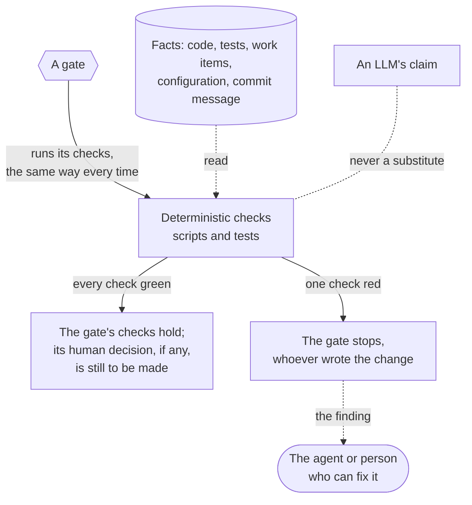
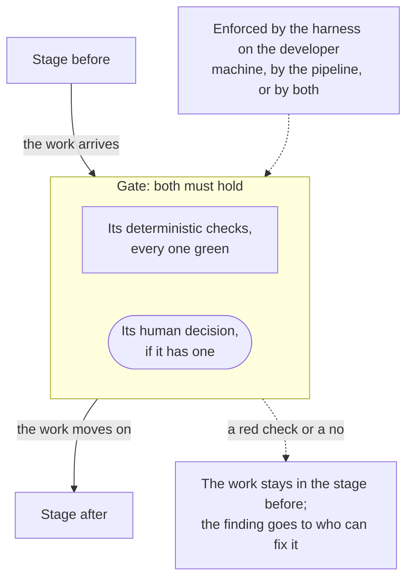

# Checks and Gates

Tests, linters and hooks verify facts instead of an LLM. They run the same way every time, and a failing check stops the
gate that runs it, whoever wrote the change. Gates are the transitions between the stages of the process: each bundles
the checks that must pass and the human decision that must be made, if any, before the work moves on.

## Deterministic Checks

A check is run by a gate, reads facts rather than claims, and has two outcomes:

| Check                   | What it verifies                                                                                                                                                               |
| ----------------------- | ------------------------------------------------------------------------------------------------------------------------------------------------------------------------------ |
| Formatter               | Code and docs have one format (for example Prettier); it formats and re-stages, so it never rejects a commit                                                                   |
| Linter, static analysis | Code rules and known bug patterns (for example ESLint, Checkstyle, PMD)                                                                                                        |
| Type check              | The code compiles against its types                                                                                                                                            |
| Tests                   | Unit, contract and journey tests of the affected modules; the full suite, including integration, end-to-end and performance tests, in CI                                       |
| Acceptance coverage     | Every acceptance criterion with an ID is pinned by a test, and every such test points to an existing criterion                                                                 |
| Work item linter        | Work item files follow the agreed form: sections, states, effort, dependencies and links                                                                                       |
| Schema validation       | Configuration, data contracts and harness files (agent and skill definitions, tool settings, ledger entries, work item metadata) match their schemas (for example JSON Schema) |
| Commit message check    | Title, qualifier and trailers follow the agreed form; the effort matches the work item; no agent attribution                                                                   |
| Dependency rules        | Allowed dependency and tool versions (for example Maven Enforcer)                                                                                                              |
| Security scan           | Known vulnerabilities in dependencies (for example OWASP dependency-check, npm audit)                                                                                          |
| Documentation lint      | API documentation that exists is well formed (for example Javadoc doclint)                                                                                                     |
| Code coverage           | Which code the tests reach, as information for the review, never as a target (for example JaCoCo)                                                                              |
| Benchmarks              | Performance, accessibility and web quality scores against earlier runs, from stored snapshots (for example Lighthouse, axe)                                                    |
| Agent smoke test        | Every agent starts in every supported tool with the right model and returns its report                                                                                         |
| Baseline delivery       | The sample issue is delivered end-to-end in each supported tool and leaves the expected commits and ledger entry                                                               |

## Gates

A gate can be enforced on the developer machine by the harness (skills, agents and git hooks), in the
[delivery pipeline](environments.md#delivery-pipeline), or in both: the checks of a gate the harness enforces locally
run again in the pipeline, so no change gets past them by skipping the local step. Gates range from fully open to fully
human.

The gates a work item passes, each with its checks and its human decision, are told with the item's life on
[The Life of a Work Item](process.md). The one gate off that path is the Harness Gate.

## Harness Gate

A change to the harness itself passes a gate of its own, so a process change is tested like a delivery before it is in
use.

| Gate         | From stage → to stage   | Deterministic checks                | Human decision                       |
| ------------ | ----------------------- | ----------------------------------- | ------------------------------------ |
| Harness Gate | Harness change → in use | Agent smoke test, baseline delivery | Engineer gives the commit permission |
