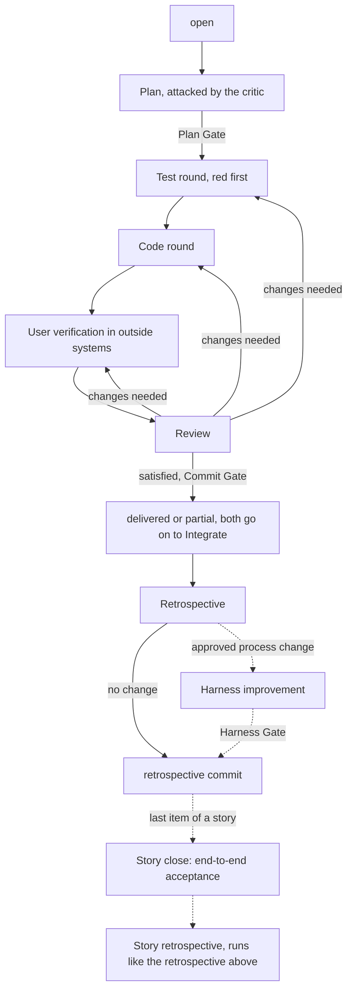

# The Deliver Run

One deliver run takes one open work item to a commit. The Delivery Lead Agent runs it and hands every other agent
pointers to the work item and the plan, never its own summary of them. The run has four steps; each ends at a human
touchpoint, and the review can send the work back to any earlier step.



## Plan

```stage
Purpose: agree how the work item is built before any code is written
Starts when: the Engineer starts the deliver run on an open work item whose dependencies are delivered
Who: Engineer, Delivery Lead Agent, Plan Critic Agent, Research Agent; Plan Issue skill
Steps:
1. The Delivery Lead Agent drafts the plan from the code; the plan grows in edits the Engineer sees
2. Open questions are settled in dialogue with the Engineer
3. The Plan Critic Agent attacks the draft against the code and the rules; the plan is revised until it passes
4. The Engineer approves the plan
Produces: the approved plan, kept for the run only, as the contract the other agents read
Gate: Plan Gate
Human touchpoint: the Engineer approves with the critic's findings and their fate in front of them
Way back: a change to the requirement sends the work item back to [Specify](process.md#specify)
```

## Build Rounds

```stage
Purpose: pin the acceptance criteria by tests, then write the code that passes them
Starts when: the plan is approved
Who: Test Agent, Code Agent, Delivery Lead Agent
Steps:
1. The Test Agent writes the journey tests from the plan's acceptance criteria, with the flag on and off where the work item names one; they fail, because the code does not exist yet
2. The Code Agent writes the production code until the tests pass; it never edits tests
3. The Test Agent adds contract tests for the new public modules
Produces: tests and code in the working tree, not yet committed
Gate: none; the checks run at the Commit Gate
Human touchpoint: only rulings the run cannot make itself, such as when to run a long verification step
Way back: a journey test that would have to change stops the round, because that changes the acceptance; a ruling that changes the plan is recorded in the plan as a dated decision
```

## Verify and Review

```stage
Purpose: prove the change works where tests cannot reach, and that it matches plan, work item and rules
Starts when: the tests pass
Who: Engineer, Reviewer Agent, Delivery Lead Agent
Steps:
1. The Delivery Lead Agent hands the Engineer a numbered list of manual steps in the outside systems the plan names, each with the exact action and the observation that proves it; it runs the repository commands next to them itself
2. The Engineer reports each step as done, changed or failed, with the observation in their own words
3. The Reviewer Agent runs the tests and reviews the test and code changes and the reported results; it trusts no claim it has not checked
4. The Reviewer Agent returns a verdict: changes needed, with feedback items for each agent or the Engineer, or satisfied
Produces: the results of the manual steps, the verdict and the feedback items
Gate: none; a satisfied verdict opens the Commit Gate
Human touchpoint: the Engineer reports what they observed, not a plain approval; a report such as "all fine" is asked again
Way back: each feedback item goes to the agent or person it names, then the review runs again
```

## Commit and Learn

```stage
Purpose: close the run with one traceable commit and learn from how the run went
Starts when: the Reviewer Agent is satisfied
Who: Engineer, Delivery Lead Agent, Reviewer Agent, Retrospective Agent
Steps:
1. The Reviewer Agent prepares the commit: what it contains, the Commit Gate checks green, the message with its trailers
2. The Engineer gives the commit permission; the Delivery Lead Agent commits and moves the work item to delivered, or to partial when only part is done, in the same commit
3. The Retrospective Agent measures the run (rounds, estimate against actual effort, token use) and proposes only process changes with evidenced impact; no proposal is a valid outcome
4. The Engineer picks the proposals to apply; the run ends with a retrospective commit that carries them and the token ledger entry
5. When the work item was the last open item of a story, the Engineer checks the story's end-to-end acceptance and a retrospective of the whole story follows
Produces: the delivery commit, the retrospective commit and the ledger entry
Gate: Commit Gate; Harness Gate for every process change the retrospective applies
Human touchpoint: the commit permission, and picking the retrospective's proposals
Way back: a partial work item starts a new deliver run for the rest; the part already committed goes on to [Integrate](process.md#integrate) like any other commit
```
