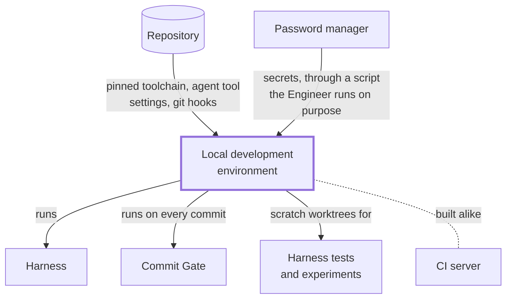
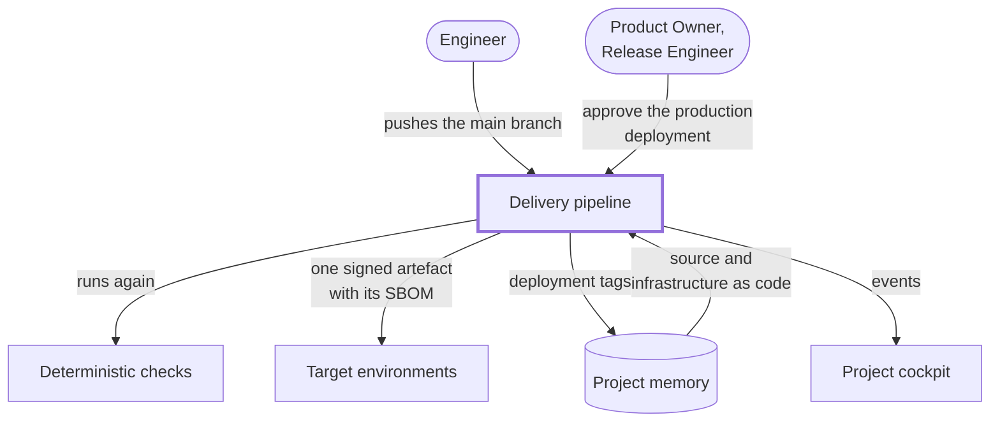
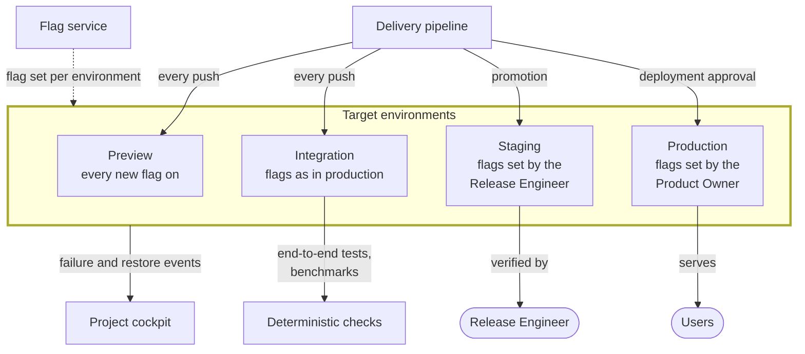
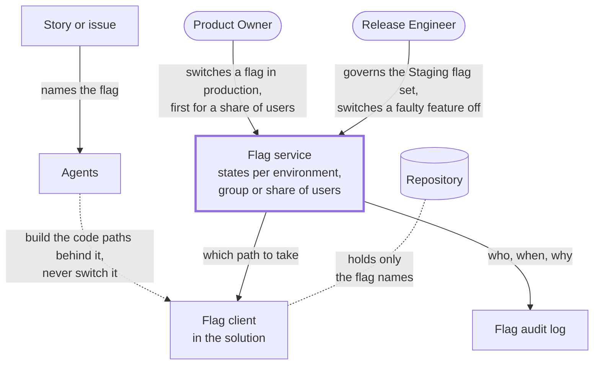

# Environments and Pipeline

The process runs on the developer machine, proves every change again in a pipeline and deploys it through a chain of
environments. Feature flags separate deploying a change from releasing it to users.

## Local Development Environment

The agentic process runs on the developer machine ("CLI first"), so the machine is part of the process and is set up the
same way for every engineer and for CI.

| Name                   | Role                                                                                                                                                               |
| ---------------------- | ------------------------------------------------------------------------------------------------------------------------------------------------------------------ |
| Reproducible Toolchain | Every tool pinned to an exact version and installed from the repository (for example a Nix flake or version files), so a machine and CI build alike                |
| Agent Tool Settings    | Repository-level settings for each agentic CLI tool: permissions, denied reads of secret files, agent memory and agent attribution switched off                    |
| Git Hooks              | The hooks the setup switches on, which run the Commit Gate locally on every commit                                                                                 |
| Secrets Provisioning   | Provides every secret the engineer and the agents need from a password manager, through a script the engineer runs on purpose, into prefixed environment variables |
| Scratch Worktrees      | Separate, git-ignored working trees for harness tests and experiments, so they never touch the engineer's working tree                                             |

## Delivery Pipeline

The pipeline is a full Continuous Integration and Continuous Delivery (CI/CD) chain from a commit to production. It runs
the [deterministic checks](checks-and-gates.md#deterministic-checks) again on a clean machine, and its events are the
source of the DevOps Research and Assessment (DORA) metrics the [Business Case](the-case.md#business-case) is measured
with.

| Name                   | Role                                                                                                                 |
| ---------------------- | -------------------------------------------------------------------------------------------------------------------- |
| CI Server              | Runs the full build, all tests and the Integration Gate on a clean machine for every push to the main branch         |
| Artefact Registry      | Stores the versioned, signed artefacts with their Software Bill of Materials (SBOM) and provenance                   |
| Infrastructure as Code | Describes every environment in the repository, so the pipeline can create and change it                              |
| Delivery Events        | Offers the deployment events and their outcome through an API, the base the cockpit calculates the DORA metrics from |

## Delivery Target Environments

With trunk-based delivery, every push to the main branch is built once and deployed. Preview and Integration run the
same deployment and differ only in their flag set. Staging holds the release candidate, and the Release Engineer governs
its flag set to verify what is about to reach users. Every environment offers its failure and restore events through an
API, for the delivery event log; live monitoring is out of scope of the model.

| Environment | Purpose                                                                        | Deployed                            | Flag set                         | Data                          |
| ----------- | ------------------------------------------------------------------------------ | ----------------------------------- | -------------------------------- | ----------------------------- |
| Preview     | Shows what is coming: the latest change with every new flag switched on        | On every push                       | Cutting edge                     | Synthetic                     |
| Integration | Proves the latest change does not break what users see today                   | On every push                       | Same as production               | Synthetic                     |
| Staging     | Lets the Release Engineer verify the release candidate before it reaches users | On promotion of a release candidate | Governed by the Release Engineer | Anonymised or production-like |
| Production  | Serves the users                                                               | On the human deployment approval    | Switched by the Product Owner    | Real                          |

A release candidate is the artefact of a main-branch commit that the Release Engineer picks for the next production
deployment; the pick is what promotes it to Staging.

## Feature Flag Management

Feature flags let a user-facing change go to the main branch before it is released, so committing and releasing stay
separate decisions. They are used sparingly: a change gets a flag only where users would see it and someone must be able
to switch it; everything else ships as an additive change or behind a versioned API, because every flag is a code path
to test twice and to remove later. The story or the issue names the flag; agents build the code paths behind it and
never switch a flag, in no environment. A flag changes by a human's hand, or by an environment's standing rule such as
Preview's every new flag on.

| Name           | Role                                                                                                                    |
| -------------- | ----------------------------------------------------------------------------------------------------------------------- |
| Flag Service   | Holds the flag states outside the repository and changes them at runtime, per environment, user group or share of users |
| Flag Client    | The part of the solution that asks the flag service which code path to take; the repository holds only the flag names   |
| Flag Audit Log | Records who changed which flag, when and why                                                                            |
