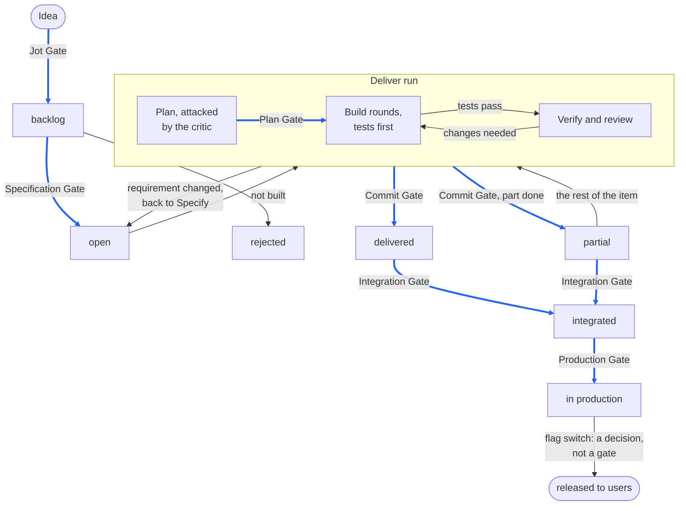

# The Life of a Work Item

The process follows one work item from an idea to a feature that users see. It moves through the states the tracker
saves; the [gates](checks-and-gates.md#gates) between them decide when it may move on. The deliver run is the one place
where several steps happen without a saved state in between: from the plan to the commit, the work exists only in the
run and the working tree, and the Plan Gate is a checkpoint inside it, so what the plan decided reaches the repository
through the run's commits. A work item ends at "delivered" once its change is committed. A partial delivery is committed
the same way and goes all the way to production; "partial" only says that the item cannot be closed yet, and a new run
takes the rest. An idea that is not worth building moves from the backlog to "rejected" without passing a gate.

The whole machine, with the side paths and the Plan Gate inside the deliver run; the thick blue arrows are the gates,
every other transition passes none:



Follow one work item along its main path. Each step names the gate it passes, with the checks that must be green and the
human decision that must be made:

```gates
Idea
-- Jot Gate | none: every jot is accepted | none
Backlog
-- Specification Gate | work item linter, schema validation | the Product Owner accepts the specified work item
Open
-- Plan Gate | none | the Engineer approves the plan after the Plan Critic Agent attacked it
Planned, inside a deliver run
-- Commit Gate | formatter, linter, type check, tests, acceptance coverage, work item linter, schema validation, commit message check | the Engineer gives the commit permission
Delivered
-- Integration Gate | full tests, schema validation, dependency rules, security scan, documentation lint, code coverage, end-to-end and performance tests against Integration, benchmarks | manual penetration tests, where the change calls for them
Integrated
-- Production Gate | none beyond the Integration Gate | the Release Engineer and the Product Owner approve the deployment after verifying on Staging
In production
-- Flag switch | none: releasing is a decision, not a gate | the Product Owner switches the feature's flag
Released to users
```

Every stage below is described in the same form: its purpose, when it starts, who is involved (the
[personas](building-blocks.md#personas), [agents](building-blocks.md#agents) and [skills](building-blocks.md#skills)),
the steps in order, what it leaves in the project memory or the environments, the gate that ends it, what the human does
and how that is made hard to just accept, and where a failure or a change sends the work.

## Capture

```stage
Purpose: keep an idea or a follow-up without stopping the current work
Starts when: anyone has an idea, or an agent finds a follow-up during a run
Who: Engineer, Delivery Lead Agent; Issue Tracker skill
Steps:
1. The idea is written into the backlog as a title plus a line or two
Produces: a jot in the backlog
Gate: Jot Gate
Human touchpoint: none; a jot costs nothing and decides nothing
Way back: none
```

## Triage

```stage
Purpose: keep the backlog small and find the one item worth specifying next
Starts when: the Engineer looks for the next work
Who: Engineer; Triage Backlog skill
Steps:
1. The skill reads every backlog item and checks it against the code
2. It gives each item a verdict: remove, leave or specify
3. It recommends the one item to specify next
Produces: a smaller backlog and a recommendation
Gate: none; triage changes no state except removing items
Human touchpoint: the Engineer decides on each verdict
Way back: none
```

## Specify

```stage
Purpose: turn an idea into work items whose outcome can be tested
Starts when: the Engineer picks an item from the backlog, or brings a new idea
Who: Engineer, Product Owner; Specify Issue skill
Steps:
1. Engineer and agent hold a design dialogue: assessments, alternatives, the "do nothing" option
2. The skill writes one or more work items, or a story, with acceptance criteria, effort, dependencies and, where users would see the change, the flag it ships behind; every edit is visible to the Engineer
3. The work item linter and the schema validation run
4. The Product Owner accepts the work items
Produces: open work items, each acceptance criterion with an ID that a test will pin
Gate: Specification Gate
Human touchpoint: the Engineer settles the open questions in the dialogue; the Product Owner accepts what is built
Way back: an idea that is not worth building is rejected or stays in the backlog
```

## Deliver

One deliver run takes one open work item to a commit. The Delivery Lead Agent runs it with the Deliver Issue skill and
hands every other agent pointers to the work item and the plan, never its own summary. The run has four steps, each
ending at a human touchpoint, and a page of its own: [The Deliver Run](deliver-run.md).

## Integrate

```stage
Purpose: prove the change on a clean machine and against what users see today
Starts when: the Engineer pushes to the main branch
Who: Engineer; CI server
Steps:
1. The pipeline builds the artefact once and runs the full set of checks
2. It deploys the artefact to Preview and Integration
3. End-to-end and performance tests and benchmarks run against Integration
4. Manual penetration tests run where the change calls for them
Produces: the signed artefact with its SBOM, and deployment tags in the deployment history
Gate: Integration Gate
Human touchpoint: the push; manual penetration tests where needed
Way back: a failing check stops the artefact; the fix comes as a new delivery
```

## Release Candidate

```stage
Purpose: verify what is about to reach users, in an environment close to production
Starts when: a release candidate is promoted to Staging
Who: Release Engineer, Product Owner
Steps:
1. The release candidate is deployed to Staging
2. The Release Engineer sets the Staging flag set and verifies the release candidate
3. Release Engineer and Product Owner approve the production deployment
4. The pipeline deploys the same artefact to production and tags the deployment
Produces: a production deployment and its tag
Gate: Production Gate
Human touchpoint: two people approve, after verifying on Staging
Way back: a release candidate that fails verification is not deployed; the fix comes as a new delivery
```

## Release to Users

```stage
Purpose: decide when users see a feature, separately from deploying it
Starts when: a deployed feature is ready for users
Who: Product Owner, Release Engineer
Steps:
1. The Product Owner switches the feature's flag in production, first for a user group or a share of users where useful
2. The flag audit log records who changed it, when and why
3. Once the flag is fully released, a follow-up work item removes it (see [Capture](#capture))
Produces: flag changes in the flag service and its audit log
Gate: none; releasing is the Product Owner's decision
Human touchpoint: the flag switch itself
Way back: the Release Engineer switches a faulty feature off by its flag; rolling back the deployment is kept for catastrophic failures only
```
