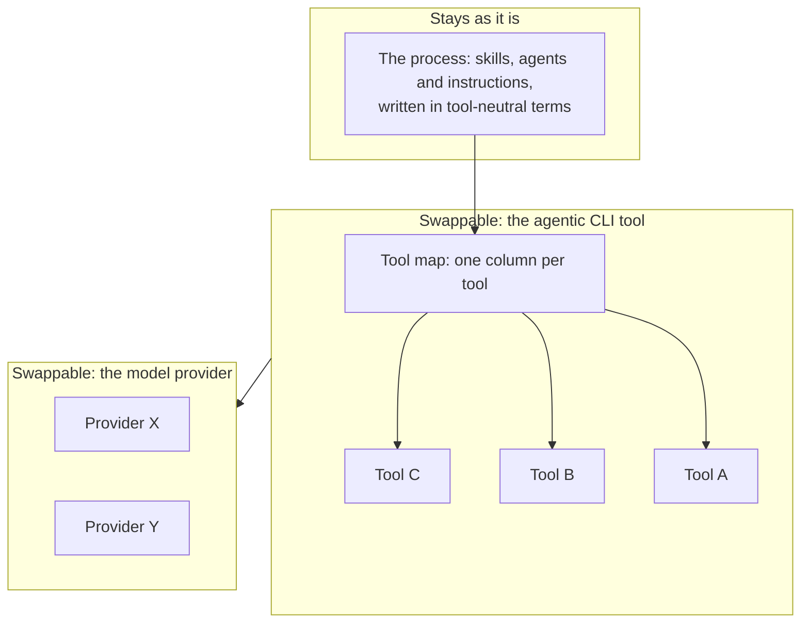
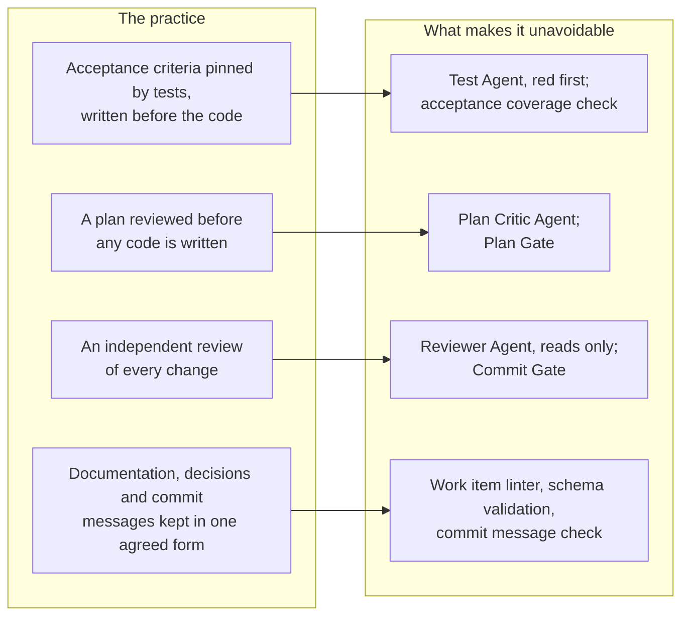
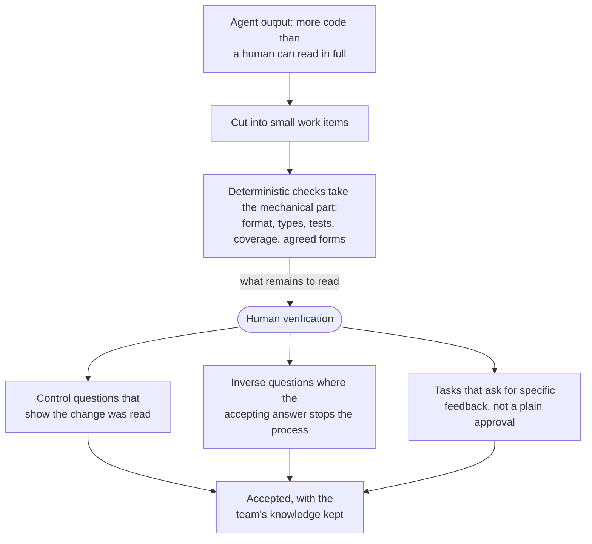

# Business and Craft Case

## Business Case

The main cost of a delivery process is the team: its people cost the same every month, however their hours are spent.
Model tokens, in contrast, are a small variable cost on top. Imagine how many autonomous development iterations you can
buy for what one senior engineer costs per day.

The goal of this process is therefore to get as much delivered output as possible out of a team's fixed cost: every
human interaction should be impactful and short, and the delivery should match the specification in the first iteration.

The business case bet is that deliberately using the most capable models, like Fable, will be more cost-effective than
having more and lower-quality iterations with cheaper or local models. Also we use the same, very capable models, to
self-improve, capture the project stakeholders' vision and improve the harness over time. Costs are optimised only once
quality and effectiveness hold, for example by moving well-specified steps to cheaper models, never before.

```mermaid
flowchart TB
  subgraph cheap[Cheaper or local model]
    b1[Specification] --> b2["Iteration: fewer tokens"] --> b3(["Human review: minutes"])
    b3 -->|not yet| b4["Iteration: fewer tokens"] --> b5(["Human review: minutes"])
    b5 -->|not yet| b6["Iteration: fewer tokens"] --> b7(["Human review: minutes"]) --> b8[Matches the specification]
  end
  subgraph capable[Most capable model]
    a1[Specification] --> a2["Iteration: more tokens"] --> a3(["Human review: minutes"]) --> a4[Matches the specification]
  end
```

Because a team's cost is fixed, the success of the process (and proof that the bet is won) can only be measured using
already established metrics, for example with the DevOps Research and Assessment (DORA) metrics (deployment frequency,
lead time for changes, change failure rate and time to restore service), before and after the process is introduced and
continuously tracking them over the whole life of a project.

The risks are rising frontier model prices and vendor lock-in. To mitigate these, we design the harness in a way that it
supports many CLI agentic tools. This ensures that we do not have vendor lock-in on the tooling level (where it hurts
the most) and that a pivot to different model providers is possible.

## Craft Case

We find that agentic delivery gives us the opportunity to 'do it right'. Many practices that in the past were skipped or
compromised on (Test-Driven Development anybody?) can now be automated and form naturally with the support of the
agentic process.

They were skipped because they cost human discipline and time. In an agentic process they become convenient: the process
treats them as first-class citizens and enforces them. Agents also need them more than humans do: tests and
deterministic checks are what stop plausible but wrong output from getting through. Best practices are therefore no
longer optional quality work but the way the process controls itself, for example:

- acceptance criteria pinned by tests, written before the code
- a plan that is reviewed before any code is written
- an independent review of every change
- documentation, decisions and commit messages kept in one agreed form

Because requirements, tests, decisions and commits all live in the repository and point to each other, every change can
be traced from requirement to commit. This makes the work auditable, eases handover and lowers the dependency on single
persons.

To measure success from the technical point of view, the DORA metrics (see above) are suited as well, as they also prove
the technical maturity of the team and its deliverables.

The risks are that agents produce more code than humans can review in a meaningful way and approving without reading
becomes tempting, with the consequence that the team's knowledge erodes. To mitigate this, work is cut into small items,
facts are checked by deterministic scripts, and human verification steps are designed so that just accepting is hard:
control questions that check the change was read, inverse questions where the accepting answer stops the process, and
tasks that ask for specific feedback instead of a plain approval.

